# 美团众包冷启动对比与逐库分析

荣耀 X70 焕新版运行 Android 16 和美团众包 APK 14.0.0.8438，**20 轮进程冷启动平均 1097.7 ms**。Mate 60 Pro 的 HarmonyOS 版历史基线到 RenderService 首帧平均 1669.2 ms，差 **571.5 ms（34.2%）**。荣耀另采 8 轮 trace 用于分段，平均 1056.2 ms，比前 20 轮低 **41.5 ms**，因此分段表与同一 Mate 基线相差 **613.0 ms**。**差距主要在应用初始化和首屏创建。** 若沿用荣耀前 20 轮、把 Mate 终点提前到 App 首绘，差值为 **554.4 ms（33.6%）**。

| 设备与日期 | 系统计时终点 | 有效轮次 | 均值 (ms) | P50 (ms) | P90 (ms) | 最快–最慢 (ms) |
|---|---|---:|---:|---:|---:|---:|
| 荣耀 X70 焕新版，2026-11-11 | Android `MainActivity` 窗口首次绘制 | 20 | **1097.7** | 1094.5 | 1186.0 | 1006.0–1195.0 |
| Mate 60 Pro，2026-11-03 | HarmonyOS RenderService 首帧 | 11 | **1669.2** | 1593.2 | 1904.9 | 1545.8–1968.6 |
| Mate 60 Pro，同一批样本 | HarmonyOS App 首绘 | 11 | 1652.1 | 1579.3 | 1881.5 | 1528.5–1945.3 |

均值为有效轮次的算术平均，P50 为中位数，P90 为最近秩。相对差值以 Mate 60 Pro 对应指标的均值为分母。

## 测试条件与计时

- **荣耀 X70 焕新版**（MTN-AN00，SM6650），Android 16（API 36），MagicOS 10.0.0.175。美团众包 Android APK 为 **14.0.0.8438**（2860，arm64-v8a），包名 `com.sankuai.meituan.dispatch.crowdsource`。通过 USB ADB 采集，电量 35%，采样前后电池温度为 32.0°C 和 35.0°C，系统热状态为 0 和 1。采集期间临时启用 USB 连接时保持亮屏，采后已恢复原设置。 采前设备状态（`honor-device-before.txt`） · 采后设备状态（`honor-device-after.txt`）
- **Mate 60 Pro**（ALN-AL00），HarmonyOS 7.0.0.125(SP51C00E125R10P3)，美团众包 HarmonyOS HAP 为 **14.0.0.006**（1400000006）。基线以 HiTrace 的 `IconStart` 为起点，分别到目标 PID 的 RenderService 首帧与 App 首绘。A00 是试采，A06 首帧前锁屏，正式统计使用其余 11 轮。 原报告（`meituan-cangjie-startup-20261103/美团众包仓颉下沉冷启动摸底.md`） · Mate 60 Pro 逐轮数据（`meituan-cangjie-startup-20261103/startup-samples.csv`）
- 两端采用进程冷启动。每轮 force-stop，启动前确认目标主进程已退出，间隔 2 秒后启动桌面入口。保留应用数据与自然页缓存。荣耀用 `am start -W` 启动 `MainSplashActivity`，框架返回最终绘制的 `MainActivity` 及 `TotalTime`。H00 为试采，耗时 1173 ms。H01–H20 全部标记为 `COLD`，均核实了新 PID、`Start proc`、前台 `MainActivity` 与屏幕唤醒状态。21 次启动的 `TotalTime` 都与同一 ActivityRecord 的 `wm_activity_launch_time` 逐轮相符。 采集脚本（`capture_android.py`） · 荣耀窗口绘制事件（`honor-launch-events.txt`） · [Android 首显定义](https://developer.android.com/topic/performance/issues/launch-time#time-to-initial-display)

这是两台设备、两套系统及各自发布包的首次显示对照。两端测试日期、应用版本和系统上报事件均不同，差值的归因范围限于这两套配置的整体表现。业务页面完全可交互耗时需另取对应终点。

## 两端启动分段

荣耀补采 8 轮 Perfetto 正式样本（T01–T08，T00 为试采），复用同一 APK、入口和进程冷启动条件。Perfetto 冷启动切片平均 **1056.2 ms**，每轮与同次 `am start -W TotalTime` 相差至多 **0.9 ms**。此前 20 轮均值 1097.7 ms 保留为端到端对照。以下分段使用同一批 trace 逐轮计算，两端均值差为 **613.0 ms**。 荣耀分段 CSV（`honor-trace-stages.csv`） · 荣耀正式样本 trace（`honor-trace/T01.pftrace`） · Mate 分段 CSV（`meituan-cangjie-startup-20261103/startup-samples.csv`）

| 连续阶段（均值，ms） | 荣耀 X70 焕新版 | Mate 60 Pro | Mate − 荣耀 |
|---|---:|---:|---:|
| 1　系统启动请求 → App 开始初始化 | 83.203 | 108.250 | +25.047 |
| 2　App 初始化开始 → 主界面创建阶段 | 750.162 | 1187.784 | **+437.622** |
| 3　主界面创建阶段 → App 首绘 | 177.945 | 356.043 | **+178.098** |
| 4　App 首绘 → 系统上报应用启动完成 | 44.874 | 17.104 | −27.770 |
| **合计** | **1056.184** | **1669.181** | **+612.997** |

差值按表中保留三位小数的两端均值计算。

Android 的分界取 `bindApplication`、`performCreate:…MainActivity`、首次 `draw-VRI[MainActivity]` 切片开始和 Perfetto 冷启动切片结束。HarmonyOS 取 `HandleLaunchApplication`、`onWindowStageCreate`、`UIVsyncTask firstDrawFrame:1` 和 RenderService 首帧。两个平台的主界面生命周期边界职责不同，分段差值用于定位耗时集中在哪个阶段。全段截止 App 首绘时，两端均值分别为 **1011.3 ms** 和 **1652.1 ms**。 [Perfetto 启动分析](https://perfetto.dev/docs/getting-started/android-trace-analysis) · HarmonyOS 锚点定义（`meituan-cangjie-startup-20261103/analyze_startup.py`）

<a name="stage-0"></a>

### 0｜两轮 trace 的全程时间轴

总图和子图使用同一个计时口径。每台设备以该轮启动请求为 **0 ms**。Mate A02 是 Mate 端到端中位样本，荣耀 T01 是用于逐库追踪的代表样本。图下表按各自 trace 精度列出耗时，和上表的多轮均值分别使用。

- **看位置。** M 是 Mate，H 是荣耀。比如 M2.4 属于总图 M2，可点击图 2 下表的编号进入。每张放大图上方的黑框标出它在整轮启动中的位置，横轴仍从整轮启动请求计时。图 0–2 的两端用同一刻度。图 3 和图 4 分别放大各自范围，跨设备时长看图下数值。
- **看粒度。** 约 10 ms 的子过程留在父图，本稿把 10–12 ms 也按这个口径处理。为核对合计，较短的动作和间隔可在父图单列或合并。
- **加时长。** 图下数字标号是互斥的时间段，合计等于父段。某个编号可以覆盖多个不连续切片，按图中原位置绘制，表里合计。灰色间隔照计入，归因以现有埋点为限。
- **看线程。** 同一主线程只占一条泳道，字母标出的主线程切片画在色条下缘。另一个 TID 才另起泳道。字母切片用于说明同一时间内发生的工作，图下耗时只加数字色段。系统交接图的首行表示跨组件的墙钟时间。

<!-- timeline:00-overview -->

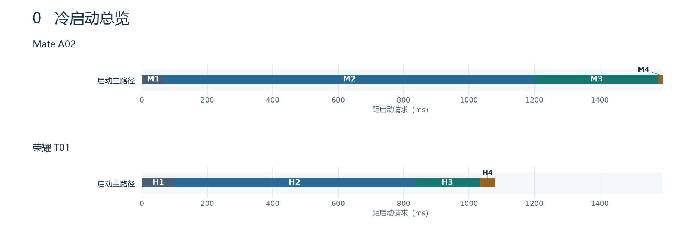

**Mate A02 · 0｜0.000–1593.201 ms**

| 标号 | 全程位置 (ms) | 耗时 (ms) | 内容 |
|---|---:|---:|---|
| [M1](#stage-1) | 0.000–69.119 | 69.119 | 系统请求到 App 开始初始化 |
| [M2](#stage-2) | 69.119–1200.381 | 1131.262 | App 初始化到主界面创建 |
| [M3](#stage-3) | 1200.381–1579.339 | 378.958 | 主界面创建到 App 首绘 |
| [M4](#stage-4) | 1579.339–1593.201 | 13.862 | App 首绘到 RenderService 上报 |
| **合计 0** | **0.000–1593.201** | **1593.201** | 启动请求到系统终点 |

**荣耀 T01 · 0｜0.000000–1080.484531 ms**

| 标号 | 全程位置 (ms) | 耗时 (ms) | 内容 |
|---|---:|---:|---|
| [H1](#stage-1) | 0.000000–100.092553 | 100.092553 | 系统请求到 App 开始绑定 |
| [H2](#stage-2) | 100.092553–833.727240 | 733.634687 | App 绑定到主界面创建 |
| [H3](#stage-3) | 833.727240–1034.069740 | 200.342500 | 主界面创建到 App 首绘 |
| [H4](#stage-4) | 1034.069740–1080.484531 | 46.414791 | App 首绘到启动切片结束 |
| **合计 0** | **0.000000–1080.484531** | **1080.484531** | 启动请求到系统终点 |

<!-- /timeline:00-overview -->

## 怎么读 SO 耗时

SO 是应用或系统使用的原生动态库。`dlopen` 是让加载器打开某个 SO 的调用。这个调用可能顺带打开它声明需要的其他 SO。本文把入口库及这次调用涉及的递归依赖叫作**依赖闭包**。加载器把库的代码和数据映射到进程，做**重定位**（填好代码或数据所需的地址），再运行**构造器**（库自己的初始化代码）。仓颉还会注册编译产物里的包与类型信息，应用随后可以运行包初始化逻辑。本文的 **TPC** 指业务入口之前先加载的仓颉初始化模块 `libohos_app_cangjie_cangjie_tpc_init.so`。**NAPI** 是 ArkTS 调用原生代码的一类接口，**FFI** 用于跨语言调用。

报告里的 `dlopen` 耗时包含这次调用内发生的工作。某个依赖的构造器已经包含在外层调用里，读表时只取一层。HarmonyOS 的 `loading: entry so` 和 `linking: entry so` 量到的是该次请求覆盖的整组库，带路径的 `calling constructors` 才能直接量到一个 SO 的构造。Android Bionic 的 `loading and linking` 把加载和链接记在一起。分摊值单独标注，原始逐库表保留阶段、线程、SO 名称或路径和切片定位。 逐库汇总（`startup-so-summary.csv`） · 逐轮切片明细（`startup-so-events.csv`） · HarmonyOS 加载器（`dynlink.c#L5789`） · [Android Bionic 加载器](https://android.googlesource.com/platform/bionic/+/refs/heads/main/linker/linker.cpp)

<a name="stage-1"></a>

## 1｜系统接到请求，开始执行 App 初始化

**Mate 108.2 ms，荣耀 83.2 ms，差 25.0 ms。** Mate 的应用管理和 appspawn 将请求交给池化进程，即系统提前准备的备用进程。到 `AppSpawnExecuteClearEnvHook` 平均 **36.9 ms**，再到应用主线程的 `HandleLaunchApplication` 用 **71.3 ms**。荣耀到目标进程的 `PostFork` 平均 **64.6 ms**，再到 `bindApplication` 用 **18.6 ms**。这两个子进程锚点位于不同平台的启动流程里，比较两侧完整阶段更合适。

<!-- timeline:01-system-start -->

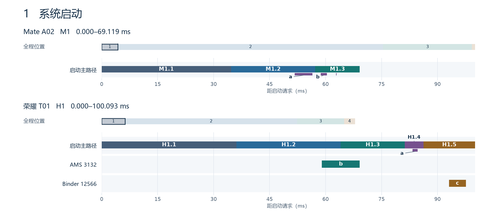

**Mate A02 · M1｜0.000–69.119 ms** · [↑ 总览](#stage-0)

| 标号 | 全程位置 (ms) | 耗时 (ms) | 内容 |
|---|---:|---:|---|
| M1.1 | 0.000–34.666 | 34.666 | 启动请求到池化进程清理钩子 |
| M1.2 | 34.666–57.229 | 22.563 | 应用进程清理、启动钩子和回复 |
| M1.3 | 57.229–69.119 | 11.890 | 环境清理结束到 App 初始化回调 |
| **合计 M1** | **0.000–69.119** | **69.119** | 与上一级标注的区间相同 |

**荣耀 T01 · H1｜0.000000–100.092553 ms** · [↑ 总览](#stage-0)

| 标号 | 全程位置 (ms) | 耗时 (ms) | 内容 |
|---|---:|---:|---|
| H1.1 | 0.000000–36.135053 | 36.135053 | 启动请求到系统分发启动进程 |
| H1.2 | 36.135053–64.055834 | 27.920781 | 分发、AMS Start proc 到 USAP 改名 |
| H1.3 | 64.055834–81.227709 | 17.171875 | USAP 改名到 PostFork |
| H1.4 | 81.227709–86.238125 | 5.010416 | PostFork 到 ActivityThreadMain |
| H1.5 | 86.238125–100.092553 | 13.854428 | ActivityThreadMain 到 bindApplication |
| **合计 H1** | **0.000000–100.092553** | **100.092553** | 与上一级标注的区间相同 |

<!-- /timeline:01-system-start -->

图中 Mate **a** 是安全组件 `libsecurity_component_client_enhance.z.so`，A02 为 **4.720 ms**。**b** 是两次 `libhitrace_meter.so`，共 **1.816 ms**。荣耀 **a** 为连接框架 JNI 库，**b** 是系统 AMS 的 `Start proc`，**c** 是 Binder 线程的 `attachApplication`。T01 的内核线程改名记录显示，本轮应用由已有的 `usap64` 进程承接。 A02 进程唤醒（`meituan-cangjie-startup-20261103/raw/A02.ftrace#L10210`） · T01 Perfetto（`honor-trace/T01.pftrace`）

按多轮平均，Mate 在该段主线程中可定位到系统安全组件 `libsecurity_component_client_enhance.z.so` 的 `dlopen` **10.0 ms**，以及跟踪组件 `libhitrace_meter.so` **1.2 ms**。荣耀相应阶段可见连接框架 `libframework-connectivity-tiramisu-jni.so` **0.9 ms**。其余时间归在系统调度、进程交接及进入应用回调之前，现有切片没有给出逐项归因。应用管理与 appspawn 团队可优先复查请求到应用回调的慢轮次。 Mate A02 启动 trace（`meituan-cangjie-startup-20261103/raw/A02.ftrace#L10210`） · 逐库明细（`startup-so-summary.csv`）

<a name="stage-2"></a>

## 2｜初始化 App，进入主界面创建

**Mate 1187.8 ms，荣耀 750.2 ms，差 437.6 ms。** Mate 此段最大的两块是业务入口前的 ArkTS 与原生依赖 **564.7 ms**，以及业务 entry 和其依赖的加载调用 **385.6 ms**。Mate 主线程实际运行 **1096.2 ms**，荣耀是 **517.9 ms**。按未舍入的数据计算，Mate 多运行 **578.3 ms**，其余调度状态少 **140.7 ms**，两项合成这一段的差距。

<!-- timeline:02-app-init -->

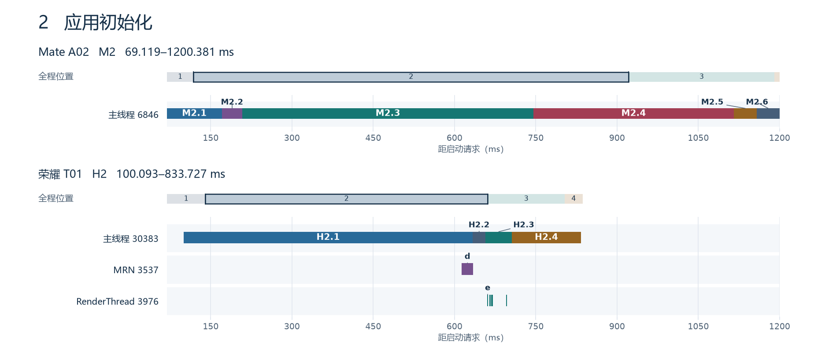

**Mate A02 · M2｜69.119–1200.381 ms** · [↑ 总览](#stage-0)

| 标号 | 全程位置 (ms) | 耗时 (ms) | 内容 |
|---|---:|---:|---|
| [M2.1](#m2-1) | 69.119–170.491 | 101.372 | AbilityRuntime 和 ArkTS 准备 |
| [M2.2](#m2-2) | 170.491–208.655 | 38.164 | 兼容桥、仓颉运行时、TPC |
| [M2.3](#m2-3) | 208.655–745.481 | 536.826 | ArkTS 求值及原生依赖，随后进入业务回调 |
| [M2.4](#m2-4) | 745.481–1115.731 | 370.250 | 业务 entry 及其递归依赖 dlopen |
| [M2.5](#m2-5) | 1115.731–1157.544 | 41.813 | dlopen 返回到仓颉业务包初始化完成 |
| [M2.6](#m2-6) | 1157.544–1200.381 | 42.837 | 业务回调收尾到窗口创建 |
| **合计 M2** | **69.119–1200.381** | **1131.262** | 与上一级标注的区间相同 |

**荣耀 T01 · H2｜100.092553–833.727240 ms** · [↑ 总览](#stage-0)

| 标号 | 全程位置 (ms) | 耗时 (ms) | 内容 |
|---|---:|---:|---|
| [H2.1](#h2-1) | 100.092553–633.443906 | 533.351353 | Android bindApplication |
| H2.2 | 633.443906–657.366719 | 23.922813 | 绑定完成到 Splash 创建 |
| H2.3 | 657.366719–705.615000 | 48.248281 | Splash 创建 |
| [H2.4](#h2-4) | 705.615000–833.727240 | 128.112240 | Splash 创建完成到 MainActivity 创建 |
| **合计 H2** | **100.092553–833.727240** | **733.634687** | 与上一级标注的区间相同 |

<!-- /timeline:02-app-init -->

A02 的仓颉接入观察窗覆盖 **M2.2 至 M2.5**，即从兼容桥开始加载到 entry 包初始化结束，全程 **170.491–1157.544 ms**，合计 **987.053 ms**。其中 M2.2 是互操作、运行时与 TPC，M2.3 包含 **536.826 ms** 的 ArkTS 求值和原生依赖等工作，M2.4 是业务库装载，M2.5 是装载返回后的业务包初始化。 [切片编号与原始位置](startup-timelines/timeline-marks.csv)

荣耀阶段二的 **d** 是 MRN 线程的 `libjscexecutor.so`，跨过绑定结束。**e** 为 Splash 创建期间 RenderThread 的图形库调用。H2.2 和 H2.3 的原主线程小项已合入父段。

<a name="m2-1"></a>

### M2.1｜兼容桥之前的 ArkTS 准备

<!-- timeline:02-m1-arkts -->

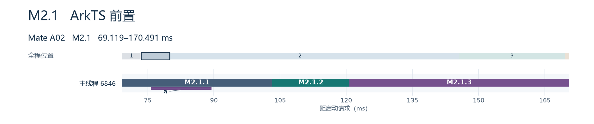

**Mate A02 · M2.1｜69.119–170.491 ms** · [↑ M2](#stage-2)

| 标号 | 全程位置 (ms) | 耗时 (ms) | 内容 |
|---|---:|---:|---|
| M2.1.1 | 69.119–103.224 | 34.105 | 框架处理应用启动并进入 Ability 回调，含创建 JS Runtime |
| M2.1.2 | 103.224–120.715 | 17.491 | 字节码读取起点到实例化起点 |
| M2.1.3 | 120.715–170.491 | 49.776 | 模块实例化及求值开头，到打开兼容桥 |
| **合计 M2.1** | **69.119–170.491** | **101.372** | 与上一级标注的区间相同 |

<!-- /timeline:02-m1-arkts -->

**a** 为 ArkTS JS Runtime 创建，耗时 **13.788 ms**。Ability 字节码读取和实例化切片自身为 **17.422 ms** 和 **49.125 ms**。短交接时间随相邻区间计入合计。

<a name="m2-2"></a>

### M2.2｜兼容桥、首次 runtime 与 TPC

<!-- timeline:02-m2-bridge -->

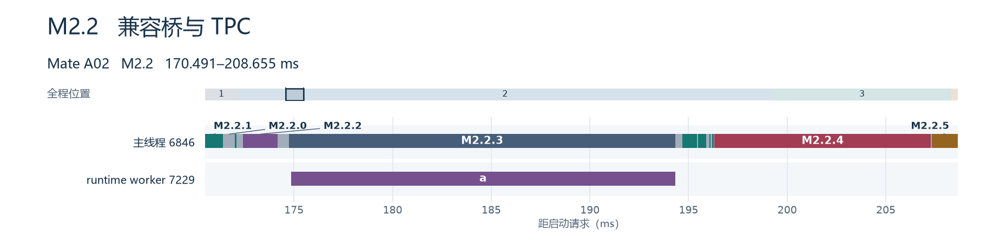

**Mate A02 · M2.2｜170.491–208.655 ms** · [↑ M2](#stage-2)

| 标号 | 全程位置 (ms) | 耗时 (ms) | 内容 |
|---|---:|---:|---|
| M2.2.1 | 6 处，见图和索引 | 2.328 | 包内兼容桥及互操作基础库调用，含系统环境库、Ark 互操作及设备信息 FFI |
| M2.2.2 | 172.403–174.160 | 1.757 | 首次打开包内 libcangjie-runtime.so 及其依赖 |
| [M2.2.3](#m2-2-3) | 174.736–194.340 | 19.604 | 主线程同步等待 runtime worker 至恢复调度 |
| M2.2.4 | 196.315–207.279 | 10.964 | dlopen TPC 及其依赖 |
| M2.2.5 | 207.315–208.655 | 1.340 | TPC 包初始化 CJRT_INIT_LIBRARY |
| M2.2.0 | 9 处，见图和索引 | 2.171 | 同一主线程上各切片之间的间隔，现有切片未逐项归因 |
| **合计 M2.2** | **170.491–208.655** | **38.164** | 与上一级标注的区间相同 |

<!-- /timeline:02-m2-bridge -->

**M2.2.1** 包含包内兼容桥 `libark_interop_loader.so`，以及系统环境、Ark 互操作和设备信息 FFI 库。**M2.2.2** 是包内 `libcangjie-runtime.so` 首次装载，包含原生支撑库 `libboundscheck.so`。**M2.2.4** 是 TPC 库 `libohos_app_cangjie_cangjie_tpc_init.so` 及其依赖的装载，随后执行 **M2.2.5** 的 TPC 包初始化。TPC 装载内出现标准库、包内 API 和差分库的构造切片。这些短项保留父段计时。 仓颉切片索引（`meituan-cangjie-startup-20261103/cangjie-trace-slices.csv`）

<a name="m2-2-3"></a>

#### M2.2.3｜主线程等待仓颉运行时初始化

<!-- timeline:02-m2-runtime-wait -->

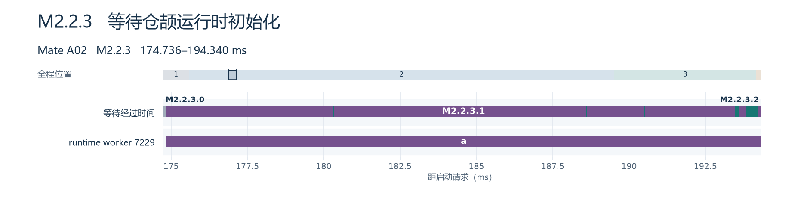

**Mate A02 · M2.2.3｜174.736–194.340 ms** · [↑ M2.2](#m2-2)

| 标号 | 全程位置 (ms) | 耗时 (ms) | 内容 |
|---|---:|---:|---|
| M2.2.3.1 | 9 处，见图和索引 | 18.881 | runtime worker 执行 CJRT_CreateAndInit 时占用 CPU |
| M2.2.3.2 | 10 处，见图和索引 | 0.585 | runtime worker 初始化期间的其他调度状态 |
| M2.2.3.0 | 2 处，见图和索引 | 0.138 | 所分析切片前后的其余时间 |
| **合计 M2.2.3** | **174.736–194.340** | **19.604** | 与上一级标注的区间相同 |

<!-- /timeline:02-m2-runtime-wait -->

**a** 为 worker 7229 上的 `CJRT_CreateAndInit`，持续 **19.466 ms**，完全落在主线程 **19.604 ms** 的等待窗口里。上方色条用 worker 的调度记录解释等待时间，其中 **18.881 ms** 在 CPU 上执行。运行时源码显示，此调用创建运行时实例并初始化页池、栈、并发、堆、类型信息和加载器等组件。A02 的运行时初始化只有外层埋点，尚无法按这些组件量时。即便库从系统路径装载，是否能省这段仍取决于子进程能否复用运行时状态。 A02 调度和初始化（`meituan-cangjie-startup-20261103/raw/A02.ftrace#L34146`） · 本地运行时源码（`cangjie_runtime/runtime/src/CangjieRuntime.cpp#L102`）

<a name="m2-3"></a>

### M2.3｜TPC 完成后，ArkTS 拉起原生库

<!-- timeline:02-m3-native -->

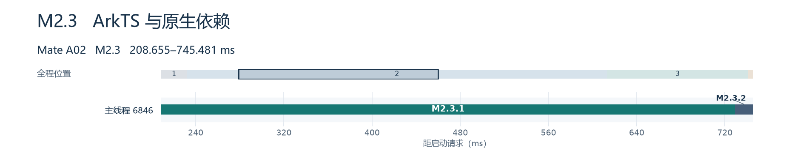

**Mate A02 · M2.3｜208.655–745.481 ms** · [↑ M2](#stage-2)

| 标号 | 全程位置 (ms) | 耗时 (ms) | 内容 |
|---|---:|---:|---|
| [M2.3.1](#m2-3-1) | 208.655–729.188 | 520.533 | TPC 包初始化完成后仍在 ArkTS 模块求值，期间打开原生库 |
| M2.3.2 | 729.188–745.481 | 16.293 | ArkTS 求值结束，经业务 onCreate 到打开 entry |
| **合计 M2.3** | **208.655–745.481** | **536.826** | 与上一级标注的区间相同 |

<!-- /timeline:02-m3-native -->

<a name="m2-3-1"></a>

#### M2.3.1｜ArkTS 模块求值中的原生调用

<!-- timeline:02-m3-evaluate -->

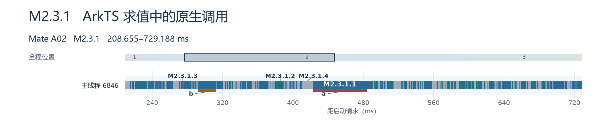

**Mate A02 · M2.3.1｜208.655–729.188 ms** · [↑ M2.3](#m2-3)

| 标号 | 全程位置 (ms) | 耗时 (ms) | 内容 |
|---|---:|---:|---|
| M2.3.1.1 | 138 处，见图和索引 | 308.790 | 只有 dlopen 切片 |
| M2.3.1.2 | 133 处，见图和索引 | 52.325 | 只有 NAPI 模块初始化切片 |
| M2.3.1.3 | 3 处，见图和索引 | 1.754 | dlopen 与 NAPI 初始化重叠，时间只计一次 |
| M2.3.1.4 | 269 处，见图和索引 | 157.664 | 两类切片之外的 ArkTS 求值时间 |
| **合计 M2.3.1** | **208.655–729.188** | **520.533** | 与上一级标注的区间相同 |

<!-- /timeline:02-m3-evaluate -->

**a** 是美团 MRN `libmrn.so`（**61.414 ms**），**b** 是系统扫码 `libcustomscan_napi.z.so`（**20.802 ms**）。两者已在图中 `dlopen` 里计时。各自的依赖闭包重定位占 **45.463 ms** 和 **15.030 ms**。WebView 和语音合成也是这批原生调用中的叶项。M2.3.1 中两类切片合并覆盖 **362.869 ms**。按完整 M2.3 窗口计，两类合并覆盖 **363.512 ms**，差 **0.643 ms** 来自求值结束后的四次主线程 `dlopen`。 原始模块求值（`meituan-cangjie-startup-20261103/raw/A02.ftrace#L33381`） · 逐库切片（`startup-so-events.csv`）

<a name="m2-4"></a>

### M2.4｜业务 entry 与递归依赖加载

<!-- timeline:02-m4-entry -->

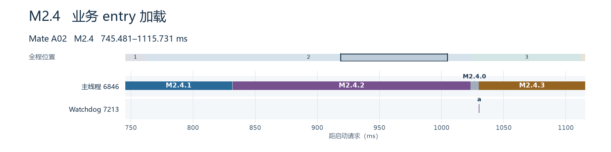

**Mate A02 · M2.4｜745.481–1115.731 ms** · [↑ M2](#stage-2)

| 标号 | 全程位置 (ms) | 耗时 (ms) | 内容 |
|---|---:|---:|---|
| M2.4.1 | 745.494–831.350 | 85.856 | 查找、打开和映射 entry 及本次依赖闭包 |
| M2.4.2 | 832.106–1023.205 | 191.099 | entry 与依赖闭包重定位和链接 |
| [M2.4.3](#m2-4-3) | 1029.858–1115.700 | 85.842 | 构造窗口，含 415 个构造器及切片间隙 |
| M2.4.0 | 4 处，见图和索引 | 7.453 | 构造窗口以外的其余间隔 |
| **合计 M2.4** | **745.481–1115.731** | **370.250** | 与上一级标注的区间相同 |

<!-- /timeline:02-m4-entry -->

**a** 为 Watchdog 线程的符号查找。构造窗口 M2.4.3 从第一个构造切片开始，到最后一个构造切片结束，共 **85.842 ms**。其中构造切片实际占 **83.347 ms**，内部间隔 **2.495 ms**。M2.4.0 的 **7.453 ms** 与构造内部间隔合为 **9.948 ms**，对应原 `dlopen` 拆解里的其余时间。加载和重定位是同次请求的闭包级耗时。

| 编号 | 实测墙钟 | 主线程在 CPU 上 | 代码对应工作 |
|---|---:|---:|---|
| M2.4.1 加载 | 85.856 ms | 85.795 ms | 加载器读取入口及依赖头、构建加载任务、把库映射进进程 |
| M2.4.2 重定位 | 191.099 ms | 191.006 ms | 加载器在 `reloc_all` 中遍历待处理的库，解析并写入所需地址，处理 RELRO 等 |

两段均未录到逐库子切片。业务入口自身的 **222 个直接依赖、97,352 条 RELA、278,100 个展开 RELR 目标**来自 ELF 文件审计，可帮助选埋点位置。要比较下沉前后具体哪个库省了多少，需用逐库路径、复用状态、映射及重定位埋点量时。 加载 trace（`meituan-cangjie-startup-20261103/raw/A02.ftrace#L101280`） · 链接 trace（`meituan-cangjie-startup-20261103/raw/A02.ftrace#L108563`） · 加载器源码（`dynlink.c#L5789`） · ELF 审计（`meituan-cangjie-startup-20261103/elf-relocation-audit.csv`）

<a name="m2-4-3"></a>

#### M2.4.3｜在同一主线程上按库分类

<!-- timeline:02-m4-constructors -->

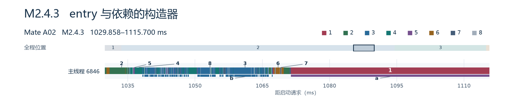

**Mate A02 · M2.4.3｜1029.858–1115.700 ms** · [↑ M2.4](#m2-4)

| 标号 | 全程位置 (ms) | 耗时 (ms) | 内容 |
|---|---:|---:|---|
| 1 | 2 处，见图和索引 | 44.554 | 业务仓颉库，含 entry 自身（2 个） |
| 2 | 33 处，见图和索引 | 6.376 | 仓颉标准库与扩展库（33 个） |
| 3 | 140 处，见图和索引 | 18.615 | 仓颉 OHOS 和 Kit API（140 个） |
| 4 | 104 处，见图和索引 | 8.576 | 仓颉互操作 API 与系统 FFI（104 个） |
| 5 | 92 处，见图和索引 | 1.347 | 包内兼容差分库（92 个） |
| 6 | 25 处，见图和索引 | 2.389 | 应用原生支撑与三方库（25 个） |
| 7 | 19 处，见图和索引 | 1.490 | 其余系统库（19 个） |
| 8 | 414 处，见图和索引 | 2.495 | 构造窗口内构造切片之间的间隔 |
| **合计 M2.4.3** | **1029.858–1115.700** | **85.842** | 与上一级标注的区间相同 |

<!-- /timeline:02-m4-constructors -->

图中 **1–8** 均属于 M2.4.3，按原始顺序在主线程泳道上着色。右上角颜色与类别数字对应，轴上的数字指向该类最长的切片。同色短条按相同类别计时，每个 SO 的路径和切片行号见索引。**a** 指类别 1 中 `libohos_app_cangjie_entry.so` 自身的构造。 [放大 M2.4.3.a](#m2-4-3-a) [415 个构造切片的路径与时间](startup-timelines/timeline-marks.csv)

**b** 是类别 3 的 140 个仓颉 OHOS／Kit API 构造内所执行的 `CJRT_LOAD_LIBRARY`，合计 **15.823 ms**，其中 **11.197 ms** 位于包与类型注册切片。其余 **2.792 ms** 落在仓颉运行时切片之外。这些数字已经计入类别 3 的 **18.615 ms**。

<a name="m2-4-3-a"></a>

#### M2.4.3.a｜业务 entry 自身构造

<!-- timeline:02-m4-entry-own -->

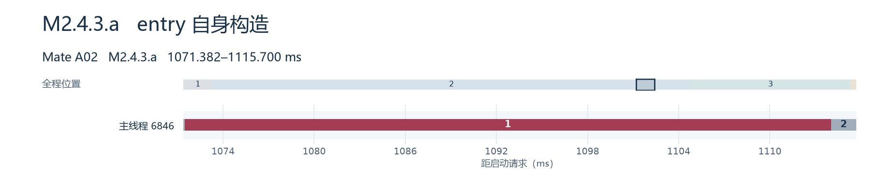

**Mate A02 · M2.4.3.a｜1071.382–1115.700 ms** · [↑ M2.4.3](#m2-4-3)

| 标号 | 全程位置 (ms) | 耗时 (ms) | 内容 |
|---|---:|---:|---|
| 1 | 1071.478–1114.028 | 42.550 | 仓颉运行时执行 CJRT_RegisterLoadFile，注册业务库 |
| 2 | 2 处，见图和索引 | 1.768 | 构造中注册切片以外的时间，含静态泛型方法表生成 |
| **合计 M2.4.3.a** | **1071.382–1115.700** | **44.318** | 与上一级标注的区间相同 |

<!-- /timeline:02-m4-entry-own -->

运行时库已在 M2.2.2 加载。此处 `CJRT_RegisterLoadFile` **42.550 ms** 对应仓颉运行时登记业务库的文件元数据、包信息、类型及扩展。A02 的该切片全程在主线程 CPU 上执行，缺少组件内部埋点。静态泛型方法表生成归入本图其余时间。 注册源码（`cangjie_runtime/runtime/src/Loader/CjFileLoader/CjFileLoader.cpp#L20`） · 注册 trace（`meituan-cangjie-startup-20261103/raw/A02.ftrace#L113501`）

<a name="m2-5"></a>

### M2.5｜dlopen 返回后初始化业务包

<!-- timeline:02-m5-init -->

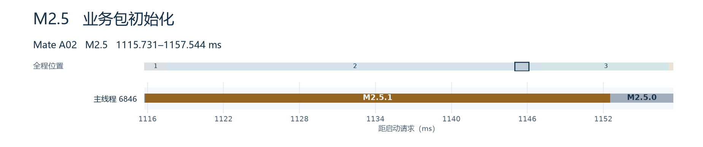

**Mate A02 · M2.5｜1115.731–1157.544 ms** · [↑ M2](#stage-2)

| 标号 | 全程位置 (ms) | 耗时 (ms) | 内容 |
|---|---:|---:|---|
| [M2.5.1](#m2-5-1) | 1115.802–1152.555 | 36.753 | CJRT_INIT_LIBRARY 内的首个仓颉任务 CJRT_INVOKE_CJTASK |
| M2.5.0 | 2 处，见图和索引 | 5.060 | 首个任务之外，含进入初始化的间隔和后续短任务 |
| **合计 M2.5** | **1115.731–1157.544** | **41.813** | 与上一级标注的区间相同 |

<!-- /timeline:02-m5-init -->

`CJRT_INIT_LIBRARY` 切片本身为 **41.763 ms**。运行时在这里调用包的全局初始化函数。首个任务占 **36.753 ms**，其余 **5.060 ms** 包含短任务和进入、退出的间隔。首个任务的可见工作包括打开 `libappkit_native.z.so`、`libuiabilitykit_native.z.so` 并查找注册入口。源码标记能确认这些动作属于包初始化，具体业务函数仍需应用侧补点。 初始化 trace（`meituan-cangjie-startup-20261103/raw/A02.ftrace#L114996`） · 全局初始化源码（`cangjie_runtime/runtime/src/Loader/CjFileLoader/CjFileLoader.cpp#L489`）

<a name="m2-5-1"></a>

#### M2.5.1｜首个仓颉包初始化任务

<!-- timeline:02-m5-first-task -->

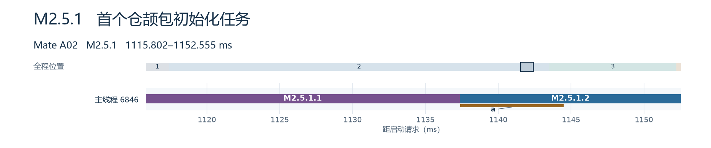

**Mate A02 · M2.5.1｜1115.802–1152.555 ms** · [↑ M2.5](#m2-5)

| 标号 | 全程位置 (ms) | 耗时 (ms) | 内容 |
|---|---:|---:|---|
| M2.5.1.1 | 1115.802–1137.349 | 21.547 | 首个任务开始到该次 Binder 请求发出 |
| M2.5.1.2 | 1137.349–1152.555 | 15.206 | 发出 Binder 请求到首个任务结束，含主线程睡眠及后续业务处理 |
| **合计 M2.5.1** | **1115.802–1152.555** | **36.753** | 与上一级标注的区间相同 |

<!-- /timeline:02-m5-first-task -->

主线程在这 **36.753 ms** 内占用 CPU **27.455 ms**。**a** 是已关联到应用 IPC 线程唤醒的 **7.094 ms** 睡眠，开始于本图标记的 Binder 请求之后。第二段还覆盖主线程醒来后的执行，整个 **15.206 ms** 以请求发出为时间分界。 发出 Binder 请求（`meituan-cangjie-startup-20261103/raw/A02.ftrace#L116979`） · IPC 线程唤醒（`meituan-cangjie-startup-20261103/raw/A02.ftrace#L118151`）

<a name="m2-6"></a>

### M2.6｜业务回调收尾，准备窗口

<!-- timeline:02-m6-window -->

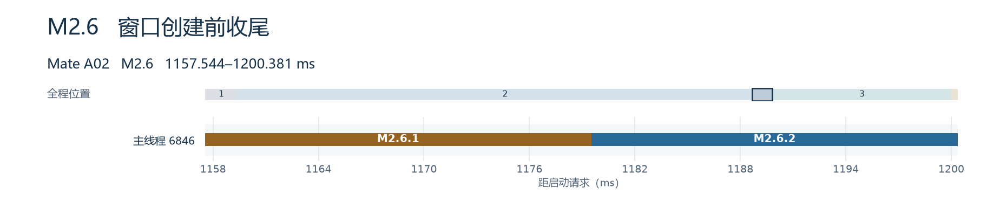

**Mate A02 · M2.6｜1157.544–1200.381 ms** · [↑ M2](#stage-2)

| 标号 | 全程位置 (ms) | 耗时 (ms) | 内容 |
|---|---:|---:|---|
| [M2.6.1](#m2-6-1) | 1157.544–1179.521 | 21.977 | 业务包初始化结束后 onCreate 收尾 |
| M2.6.2 | 1179.521–1200.381 | 20.860 | onCreate 返回后准备窗口，直到进入 onWindowStageCreate |
| **合计 M2.6** | **1157.544–1200.381** | **42.837** | 与上一级标注的区间相同 |

<!-- /timeline:02-m6-window -->

<a name="m2-6-1"></a>

#### M2.6.1｜包初始化完成后的业务回调

<!-- timeline:02-m6-late-tasks -->

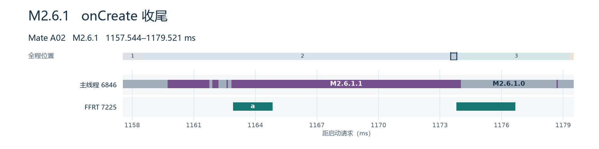

**Mate A02 · M2.6.1｜1157.544–1179.521 ms** · [↑ M2.6](#m2-6)

| 标号 | 全程位置 (ms) | 耗时 (ms) | 内容 |
|---|---:|---:|---|
| M2.6.1.1 | 6 处，见图和索引 | 13.668 | 主线程执行的 6 个仓颉任务 |
| M2.6.1.0 | 7 处，见图和索引 | 8.309 | onCreate 收尾中不在这 6 个任务切片内的时间 |
| **合计 M2.6.1** | **1157.544–1179.521** | **21.977** | 与上一级标注的区间相同 |

<!-- /timeline:02-m6-late-tasks -->

这 **21.977 ms** 已在包初始化之后。主线程执行了 6 个 `CJRT_INVOKE_CJTASK`，合计 **13.668 ms**。**a** 是 FFRT 线程同期执行的应用信息查询与偏好写入回调。具体哪段应用逻辑需要在首帧前运行，需要对照业务入口和任务投递。 后续仓颉任务 trace（`meituan-cangjie-startup-20261103/raw/A02.ftrace#L124524`）

<details>
<summary>Mate 11 轮均值与组件对照</summary>


| 子阶段 | 平均 | 负责组件及实际工作 |
|---|---:|---|
| `HandleLaunchApplication` → 兼容桥开始加载 | 105.7 ms | AbilityRuntime 和 ArkTS。创建 JS 运行环境 **14.3 ms**，处理业务 Ability 字节码到兼容桥开始前 **71.6 ms**，其中 `modules.abc` 加载 **19.0 ms**、模块实例化 **52.1 ms**。 |
| 兼容桥开始加载 → TPC 包初始化完成 | 48.8 ms | ArkTS/仓颉互操作、仓颉 runtime 和 TPC 初始化包。主线程同步等 runtime worker **29.8 ms**，worker 初始化 **29.5 ms** 与这段等待重叠。 |
| TPC 完成 → 仓颉业务入口开始加载 | 564.7 ms | ArkTS 加载业务模块。模块求值切片覆盖 **550.1 ms**，其中主线程 `dlopen` 并集 **326.5 ms**、NAPI 模块初始化并集 **57.4 ms**，这些切片可以嵌套。 |
| 仓颉业务入口 `dlopen` | 385.6 ms | HarmonyOS musl 加载入口及依赖。加载 **92.3 ms**、重定位 **203.2 ms**、构造 **80.1 ms**，其余 **10.0 ms**。主线程实际运行 **384.7 ms**。 |
| `dlopen` 返回 → entry 包初始化完成 | 39.7 ms | 仓颉 runtime 的 `CJRT_INIT_LIBRARY` 平均 **39.6 ms**，内部运行应用包初始化任务。该阶段单独发生在 `dlopen` 返回后。 |
| entry 包初始化完成 → 窗口阶段开始 | 43.3 ms | 业务 `onCreate` 尾部 **23.0 ms**，窗口场景 `scene_->Init` 在此区间内约 **19.9 ms**。后者含 `libgamecontroller_event.z.so` **4.50 ms**，另可见 Ark 调试接入库 `libark_connect_inspector.z.so` **1.64 ms**。 |

早期实际打开的仓颉库包括包内互操作桥 `libark_interop_loader.so` **0.869 ms**、首次 `libcangjie-runtime.so` **1.653 ms**、应用 `libohos_app_cangjie_cangjie_tpc_init.so` **11.197 ms**。这三项均为各自 `dlopen`，TPC 的调用内每轮看到 21 个构造器切片。运行时自身的 ELF 构造 **0.539 ms** 与启动运行时 worker 的 **29.5 ms** 是不同动作。 仓颉切片与原始行号（`meituan-cangjie-startup-20261103/cangjie-trace-slices.csv`） · runtime 等待取证（`meituan-cangjie-startup-20261103/cj-init-sync-audit.csv`）

</details>

**业务入口之前的慢 SO。** 这些是 TPC 到业务入口这 564.7 ms 里的主线程调用，平均耗时包含相应依赖。

| SO | 组件或来源 | `dlopen` 均值 | 已定位的内部工作 |
|---|---|---:|---|
| `libmrn.so` | 美团随包 MRN 原生库 | **64.53 ms** | 闭包加载 6.80、重定位 46.83、构造 9.65 ms。自身构造 2.30 ms 已包含。 |
| `libcustomscan_napi.z.so` | 系统 HMS 扫码模块 | **22.17 ms** | 闭包加载 2.38、重定位 15.87、构造 3.35 ms。 |
| `libtexttospeech.z.so` | 系统 HMS 语音合成模块 | 12.10 ms | 闭包重定位 7.08 ms。 |
| `libwebview_napi.z.so` | 系统 WebView 接口 | 11.75 ms | 闭包重定位 9.46 ms。 |
| `libmsimap.so` | 应用随包库 | 10.09 ms | 闭包重定位 7.22 ms。 |
| `libaccess.z.so` | 系统蓝牙模块 | 8.89 ms | 可定位到本次闭包调用。 |
| `libmsc.so`、`libswitchtestenv.so`、`libhorn.so`、`libfaceliveness.so` | 应用随包库 | 8.58、7.07、6.86、6.45 ms | 可逐个回查调用，业务职责需结合应用源码确认。 |

这些库在 ArkTS 模块求值期间被打开。优先检查哪条 import、NAPI 注册或首屏业务调用把它们拉入启动链，并以首屏是否真正使用为依据选择延迟时机。 A02 模块求值（`meituan-cangjie-startup-20261103/raw/A02.ftrace#L33381`） · A02 MRN 调用（`meituan-cangjie-startup-20261103/raw/A02.ftrace#L65907`） · 全部 SO 调用（`startup-so-summary.csv`）

### 仓颉 SO 的首次装载与构造证据

这轮核对按**目标应用进程本次启动中的首次装载和初始化**理解“新建”。A02 先结束旧应用进程，再由 appspawn 唤醒池化进程承接应用启动。11 轮都在首帧前看到包内 `libcangjie-runtime.so`、TPC 和业务入口的 `dlopen`，并看到本次执行的构造器。此前采后核对 appspawn，仓颉相关过滤结果只见系统 `libcj_bind_native.z.so`。应用采后 maps 则显示 runtime、标准库、API 和业务库来自应用包路径。在已分类的清单中，**299 个应用侧 SO 每轮首帧前均有路径明确的构造切片**。该数字统计本次执行构造的库，逐库 `mmap` 次数、时刻和预映射状态需新增埋点。系统 `libcj_bind_native.z.so` 采后已在应用和 appspawn 的 maps 中，11 轮应用启动 trace 未见它的构造切片，映射来源待确认。 旧进程退出记录（`meituan-cangjie-startup-20261103/raw/A02.log`） · appspawn 映射（`meituan-cangjie-startup-20261103/raw/A-mode.txt#L40`） · 应用库清单（`meituan-cangjie-startup-20261103/loaded-cangjie-so.csv`）

下面给出 11 轮平均的**单库构造器实测**。同轮后续调用再次出现 `dlopen libcangjie-runtime.so` 时，A02 对应切片未再次执行该库构造器。首轮 `dlopen` 和后续打开同名库需分别看。系统页缓存可以保留文件内容，同时新进程仍要建立自己的映射、处理重定位和初始化。加载器 namespace 是库的查找与共享范围，它的创建和 SO 的映射是两个动作。 首次 runtime 调用与构造（`meituan-cangjie-startup-20261103/raw/A02.ftrace#L33673`） · 同轮再次打开 runtime（`meituan-cangjie-startup-20261103/raw/A02.ftrace#L38396`） · 仓颉 namespace 初始化（`cj_environment.cpp#L668`）

| 所在调用 | SO | 组件 | 单库构造均值 |
|---|---|---|---:|
| 首次 runtime | `libcangjie-runtime.so` | 包内仓颉运行时 | 0.539 ms |
| 首次 runtime | `libboundscheck.so` | 包内原生支撑 | 0.013 ms |
| TPC | `libcangjie-std-core.so` | 包内标准库核心 | 0.628 ms |
| TPC | `libohos.ark_interop.so` | 包内 ArkTS/仓颉互操作 API | 0.490 ms |
| 业务入口 | `libohos_app_cangjie_entry.so` | 美团业务仓颉编译产物 | **43.269 ms** |
| 业务入口 | `libohos.component.so` | 包内仓颉组件 API | 2.297 ms |
| 业务入口 | `libcj_frontend_ohos.z.so`、`libcj_photoaccesshelper_ffi.z.so` | 系统原生 FFI 支撑 | 1.403、1.331 ms |
| 业务入口 | `libstdx.net.http.so`、`libcangjie-std-reflect.so` | 应用侧仓颉扩展库、反射标准库 | 1.036、0.960 ms |
| 业务入口 | `libxgboost.so` | 应用随包三方原生库 | 0.978 ms |
| 业务入口 | `libohos.ability.so`、`libohos.ffi.so` | 包内仓颉 API 与 FFI 封装 | 0.769、0.117 ms |
| 业务入口 | `libcj_bind_ffi.z.so`、`libcj_bind_ffi_diff.z.so` | 系统 FFI 实现、包内兼容差分 | 0.015、0.015 ms |

业务入口调用内每轮看到 **415 个直接构造器切片**，其中涵盖应用侧和系统侧。上文的 299 个按仓颉相关应用侧库分类统计，范围覆盖首帧前多个调用。入口 ELF 文件大小 **68.4 MB**，有 **222 个直接依赖**、**97,352 条 RELA 和 278,100 个展开后的 RELR 目标**，这些是文件里的静态规模指标。入口自身构造在 A02 为 **44.318 ms**，其中有仓颉运行时的包注册切片。要把闭包的 **203.2 ms** 重定位归到具体依赖，应给加载器的逐库映射和重定位循环加埋点。已有逐库模型按 ELF 文件段和重定位目标分摊，可用来挑首批验证对象。比如 A02 的 `libohos.component.so` 构造实测 **2.733 ms**，另有加载 **3.084 ms**、重定位 **16.779 ms** 的模型分摊。该库属于当前镜像尚缺同名文件的扩展目标。 入口 ELF 审计（`meituan-cangjie-startup-20261103/elf-relocation-audit.csv`） · 入口构造器 trace（`meituan-cangjie-startup-20261103/raw/A02.ftrace#L113497`） · 实测构造与分摊逐库表（`meituan-cangjie-startup-20261103/full-sinking-sdk-libraries.csv`） · 差分库明细（`meituan-cangjie-startup-20261103/removed-compat-libraries.csv`）

<a name="h2-1"></a>

### H2.1｜Android 绑定应用

<!-- timeline:02-h1-bind -->

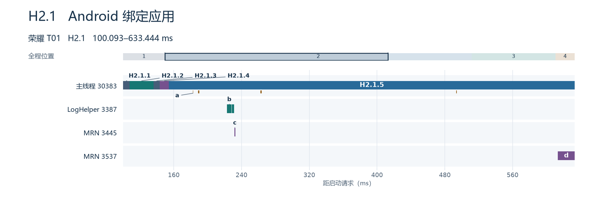

**荣耀 T01 · H2.1｜100.092553–633.443906 ms** · [↑ H2](#stage-2)

| 标号 | 全程位置 (ms) | 耗时 (ms) | 内容 |
|---|---:|---:|---|
| H2.1.1 | 100.092553–107.818438 | 7.725885 | 绑定开始到 ART 打开 DEX |
| H2.1.2 | 107.818438–136.166719 | 28.348281 | 打开 DEX，含 App Image 加载 |
| H2.1.3 | 136.166719–143.553334 | 7.386615 | ART 打开 DEX 返回到创建 Application 对象 |
| H2.1.4 | 143.553334–154.321771 | 10.768437 | 创建 Application 对象 |
| [H2.1.5](#h2-1-5) | 154.321771–633.443906 | 479.122135 | 创建对象后至绑定结束，含应用及框架初始化 |
| **合计 H2.1** | **100.092553–633.443906** | **533.351353** | 与上一级标注的区间相同 |

<!-- /timeline:02-h1-bind -->

| 字母 | 线程 | 可定位的加载 |
|---|---|---|
| a | 主线程 | `libcips.so`、`libsnare_2.0.0.so`、`libmtguard.so`、`libmtshadow.so` |
| b | LogHelper 3387 | `libstlport_shared.so`、`libmarsxlog.so` |
| c | MRN 3445 | `libunionid.so` |
| d | MRN 3537 | `libjscexecutor.so`，跨 H2.1 与 H2.2 |

<a name="h2-1-5"></a>

#### H2.1.5｜Application 创建后到绑定结束

<!-- timeline:02-h1-bind-tail -->

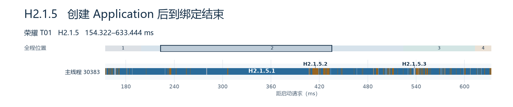

**荣耀 T01 · H2.1.5｜154.321771–633.443906 ms** · [↑ H2.1](#h2-1)

| 标号 | 全程位置 (ms) | 耗时 (ms) | 内容 |
|---|---:|---:|---|
| H2.1.5.1 | 294 处，见图和索引 | 401.364230 | 主线程占用 CPU |
| H2.1.5.2 | 258 处，见图和索引 | 64.969058 | 主线程普通睡眠 |
| H2.1.5.3 | 231 处，见图和索引 | 12.788847 | 其余调度状态，含就绪及不可中断睡眠 |
| **合计 H2.1.5** | **154.321771–633.443906** | **479.122135** | 与上一级标注的区间相同 |

<!-- /timeline:02-h1-bind-tail -->

长段以主线程占用 CPU 为主，现有 trace 的应用级子切片都较短。业务 SDK 的同步初始化仍需 `Application.onCreate` 等埋点区分。绑定结束后的 H2.2 和 H2.3 在父图保留总时间。字母 **d** 标记的 `libjscexecutor.so` 是同一次跨边界调用，完整耗时 **20.995 ms**，其中与主线程同时处于 Running 的时间为 **10.348 ms**。

<a name="h2-4"></a>

### H2.4｜Splash 创建完成，到主界面创建

<!-- timeline:02-h4-after-splash -->

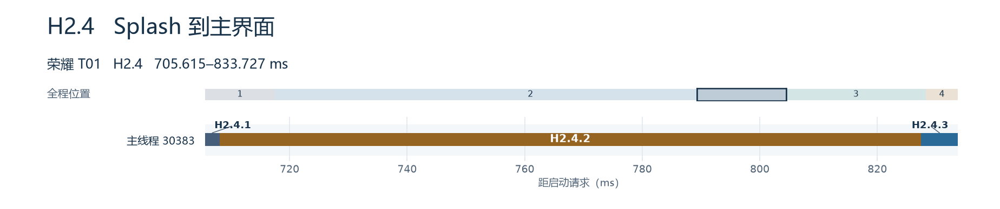

**荣耀 T01 · H2.4｜705.615000–833.727240 ms** · [↑ H2](#stage-2)

| 标号 | 全程位置 (ms) | 耗时 (ms) | 内容 |
|---|---:|---:|---|
| H2.4.1 | 705.615000–708.087031 | 2.472031 | Splash 创建结束到恢复完成 |
| [H2.4.2](#h2-4-2) | 708.087031–827.420417 | 119.333386 | Splash 恢复完成到主界面启动事务 |
| H2.4.3 | 827.420417–833.727240 | 6.306823 | 主界面启动事务到 MainActivity 创建 |
| **合计 H2.4** | **705.615000–833.727240** | **128.112240** | 与上一级标注的区间相同 |

<!-- /timeline:02-h4-after-splash -->

<a name="h2-4-2"></a>

#### H2.4.2｜Splash 恢复结束至主界面启动事务

<!-- timeline:02-h4-main-wait -->

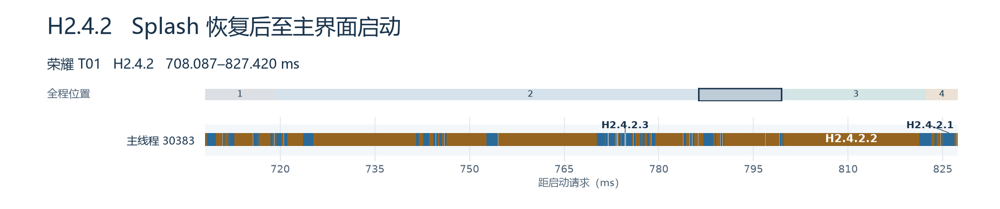

**荣耀 T01 · H2.4.2｜708.087031–827.420417 ms** · [↑ H2.4](#h2-4)

| 标号 | 全程位置 (ms) | 耗时 (ms) | 内容 |
|---|---:|---:|---|
| H2.4.2.1 | 81 处，见图和索引 | 25.305884 | 主线程占用 CPU |
| H2.4.2.2 | 77 处，见图和索引 | 91.840365 | 主线程普通睡眠 |
| H2.4.2.3 | 63 处，见图和索引 | 2.187137 | 其余调度状态，含就绪及不可中断睡眠 |
| **合计 H2.4.2** | **708.087031–827.420417** | **119.333386** | 与上一级标注的区间相同 |

<!-- /timeline:02-h4-main-wait -->

主线程以睡眠为主。系统切片可以定位开始、结束和调度状态，业务等待对象仍需应用侧埋点。

<details>
<summary>荣耀 8 轮均值与具体 SO</summary>

Android Framework 的 `bindApplication` 平均 **563.8 ms**，其中主线程运行 **454.8 ms**。ART 打开 APK 对应 DEX/OAT 的切片平均 **29.8 ms**，包含约 **27.3 ms** 的 App Image 加载。创建 Application 对象的 `makeApplication` 平均 **14.4 ms**，之后到 `bindApplication` 结束还有 **503.5 ms**，包含框架和应用初始化。此窗口缺少独立的 `Application.onCreate` 与各业务 SDK 初始化标记。H2.1–H2.4 的 8 轮均值分别为 **563.843 ms、23.036 ms、48.021 ms、115.262 ms**，合计 **750.162 ms**。H2.2–H2.4 覆盖绑定结束到 `MainActivity` 开始创建。后一段主线程约 **86.6 ms** 在睡眠，trace 暂未给出业务等待对象。 荣耀分段数据（`honor-trace-stages.csv`） · [Android ActivityThread 实现](https://github.com/aosp-mirror/platform_frameworks_base/blob/android-16.0.0_r1/core/java/android/app/ActivityThread.java#L7790)

| 线程及阶段 | SO | 平均 `dlopen` | 含义 |
|---|---|---:|---|
| 主线程，绑定 App | `libmtguard.so`、`libmtshadow.so`、`libcips.so`、`libsnare_2.0.0.so` | 1.61、0.88、0.77、0.70 ms | APK 随包原生库，4 个调用每轮都出现。 |
| 同进程工作线程，绑定及 Splash 阶段 | `libjscexecutor.so` | **15.47 ms** | MRN 工作线程发起，加载与链接合计 **14.19 ms**。 |
| 同进程工作线程，绑定 App | `libstlport_shared.so`、`libmarsxlog.so` | 2.55、2.01 ms | `LogHelper` 线程发起。 |
| 渲染线程，绑定结束后 | `libadreno_app_profiles.so`、`libiGraphicsLoader.so` | 2.05、1.09 ms | Android 设备的 GPU 配置与图形加载组件。 |

首显前，荣耀主线程可见的 Bionic `dlopen` 并集平均 **6.8 ms**，其中加载与链接 **5.7 ms**、构造 **0.5 ms**。同进程工作线程的调用各按线程去重后合计 **32.2 ms**，这组调用与主线程启动区间重叠，是否有任务阻塞主线程需进一步核对等待链。荣耀侧优先给绑定后半段的业务 SDK、Provider 与 Splash 跳转补应用内标记，找出可延期的同步初始化。 荣耀 SO 切片与线程（`startup-so-events.csv`） · 荣耀 T01 Perfetto（`honor-trace/T01.pftrace`）

</details>

<a name="stage-3"></a>

## 3｜创建主界面，画出第一帧

**Mate 356.0 ms，荣耀 177.9 ms，差 178.1 ms。** Mate 主线程运行 **205.5 ms**、其他调度状态 **150.5 ms**，荣耀对应为 **107.5 ms** 和 **70.4 ms**。

<!-- timeline:03-first-draw -->

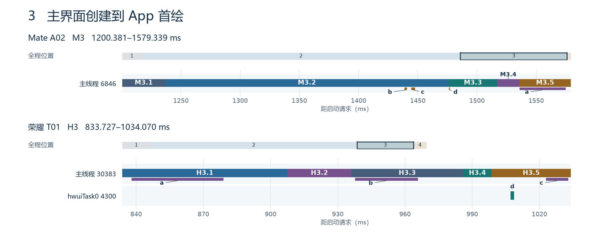

**Mate A02 · M3｜1200.381–1579.339 ms** · [↑ 总览](#stage-0)

| 标号 | 全程位置 (ms) | 耗时 (ms) | 内容 |
|---|---:|---:|---|
| [M3.1](#m3-1) | 1200.381–1236.793 | 36.412 | 窗口创建到前台事务结束 |
| [M3.2](#m3-2) | 1236.793–1475.889 | 239.096 | 前台事务结束到 ArkUI 初始化开始 |
| M3.3 | 1475.889–1517.185 | 41.296 | ArkUI 初始化开始到页面路由 |
| M3.4 | 1517.185–1535.652 | 18.467 | 页面路由开始到 VSync 任务 |
| M3.5 | 1535.652–1579.339 | 43.687 | VSync 任务开始到 App 首绘 |
| **合计 M3** | **1200.381–1579.339** | **378.958** | 与上一级标注的区间相同 |

**荣耀 T01 · H3｜833.727240–1034.069740 ms** · [↑ 总览](#stage-0)

| 标号 | 全程位置 (ms) | 耗时 (ms) | 内容 |
|---|---:|---:|---|
| H3.1 | 833.727240–907.525104 | 73.797864 | MainActivity 创建开始到 performStart，含布局加载 |
| H3.2 | 907.525104–936.005886 | 28.480782 | performStart 开始到恢复事务 |
| H3.3 | 936.005886–985.961875 | 49.955989 | activityResume 事务 |
| H3.4 | 985.961875–998.633438 | 12.671563 | 恢复事务完成到首帧 doFrame |
| H3.5 | 998.633438–1034.069740 | 35.436302 | 首帧 doFrame 开始到 App 首绘 |
| **合计 H3** | **833.727240–1034.069740** | **200.342500** | 与上一级标注的区间相同 |

<!-- /timeline:03-first-draw -->

Mate 的 **a** 是 VSync 任务内的布局，A02 为 **38.795 ms**。**b、c、d** 分别是主线程打开 `liberrormanager.z.so`、`libstatistics.z.so`、`libaps_client.z.so`。荣耀的 **a、b、c** 分别是主线程布局加载、`performResume` 回调和首帧布局。**d** 为 hwuiTask0 线程打开 QTI mapper 图形库。

<a name="m3-1"></a>

### M3.1｜窗口创建和业务前台回调

<!-- timeline:03-m1-foreground -->

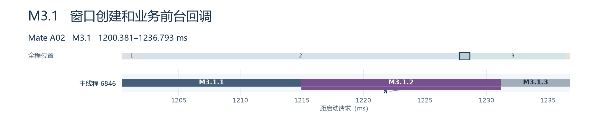

**Mate A02 · M3.1｜1200.381–1236.793 ms** · [↑ M3](#stage-3)

| 标号 | 全程位置 (ms) | 耗时 (ms) | 内容 |
|---|---:|---:|---|
| M3.1.1 | 1200.381–1214.924 | 14.543 | 窗口回调、切前台及交接 |
| [M3.1.2](#m3-1-2) | 1214.924–1231.202 | 16.278 | 业务 onForeground 回调 |
| M3.1.3 | 1231.202–1236.793 | 5.591 | 业务回调结束到前台事务完成 |
| **合计 M3.1** | **1200.381–1236.793** | **36.412** | 与上一级标注的区间相同 |

<!-- /timeline:03-m1-foreground -->

**a** 是业务 `onForeground` 内的 `CJRT_INVOKE_CJTASK`，耗时 **16.207 ms**，基本覆盖该业务回调。它属于首屏前的业务前台逻辑，计在阶段三。现有 trace 给出任务边界，回调里具体的仓颉业务函数需补埋点。 业务前台回调（`meituan-cangjie-startup-20261103/raw/A02.ftrace#L134047`） · 仓颉任务（`meituan-cangjie-startup-20261103/raw/A02.ftrace#L134055`）

<a name="m3-1-2"></a>

#### M3.1.2｜业务前台回调的仓颉任务与调度

<!-- timeline:03-m1-foreground-task -->

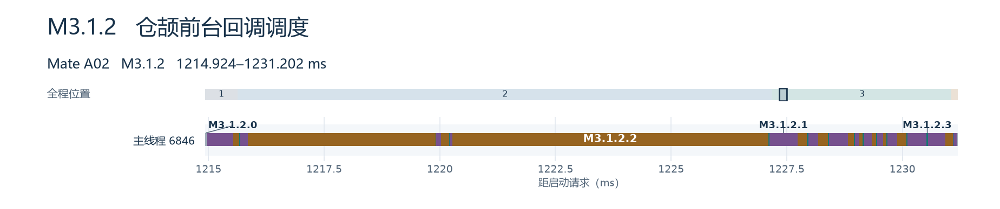

**Mate A02 · M3.1.2｜1214.924–1231.202 ms** · [↑ M3.1](#m3-1)

| 标号 | 全程位置 (ms) | 耗时 (ms) | 内容 |
|---|---:|---:|---|
| M3.1.2.1 | 14 处，见图和索引 | 3.577 | onForeground 内仓颉任务占用 CPU |
| M3.1.2.2 | 12 处，见图和索引 | 12.326 | 仓颉任务期间主线程普通睡眠 |
| M3.1.2.3 | 13 处，见图和索引 | 0.304 | 仓颉任务期间主线程就绪 |
| M3.1.2.0 | 2 处，见图和索引 | 0.071 | 所分析切片前后的其余时间 |
| **合计 M3.1.2** | **1214.924–1231.202** | **16.278** | 与上一级标注的区间相同 |

<!-- /timeline:03-m1-foreground-task -->

这次回调主要耗在主线程普通睡眠，共 **12.326 ms**。其中两次较长的睡眠都由 TID 7229 唤醒。唤醒记录确认线程间交接，等待的具体任务或锁需应用与运行时联动埋点确认。 第一次睡眠（`meituan-cangjie-startup-20261103/raw/A02.ftrace#L134212`） · 第二次唤醒（`meituan-cangjie-startup-20261103/raw/A02.ftrace#L136492`）

<a name="m3-2"></a>

### M3.2｜前台事务结束至 ArkUI 初始化

<!-- timeline:03-m2-ui-wait -->

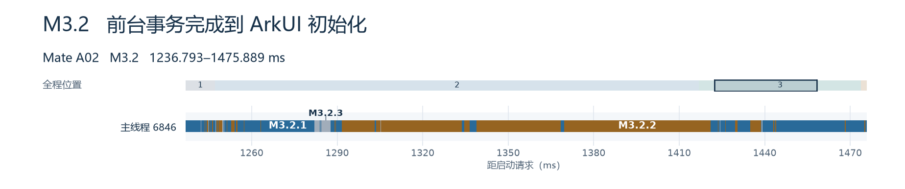

**Mate A02 · M3.2｜1236.793–1475.889 ms** · [↑ M3](#stage-3)

| 标号 | 全程位置 (ms) | 耗时 (ms) | 内容 |
|---|---:|---:|---|
| M3.2.1 | 72 处，见图和索引 | 95.527 | 主线程占用 CPU |
| M3.2.2 | 53 处，见图和索引 | 136.493 | 主线程普通睡眠 |
| M3.2.3 | 82 处，见图和索引 | 7.076 | 其余调度状态，含就绪及不可中断睡眠 |
| **合计 M3.2** | **1236.793–1475.889** | **239.096** | 与上一级标注的区间相同 |

<!-- /timeline:03-m2-ui-wait -->

调度轨迹区分主线程实际运行与离开 CPU 的时间。要解释这段等待的来源，还需要对齐任务投递、Binder 事务和唤醒事件。

- **Mate 的主要区间在应用前台事务与 ArkUI 首屏。** 前台事务结束到 `UI Initialize` 开始平均 **210.3 ms**，其中主线程睡眠约 **106.4 ms**，仍缺少等待方的完整链路。随后可见 ArkUI `UI Initialize` **37.6 ms**、页面路由 `RunPage` **12.7 ms**、首帧前 `UIVsyncTask` **44.2 ms**，最后一项含布局与测量约 **39.4 ms**。主线程显式 `dlopen` 并集仅 **14.3 ms**，包括系统网络统计 `libstatistics.z.so` **3.73 ms**、异常管理 `liberrormanager.z.so` **1.47 ms**、性能服务 `libaps_client.z.so` **1.37 ms**。 Mate UI 初始化与布局（`meituan-cangjie-startup-20261103/raw/A02.ftrace#L168907`） · 逐库清单（`startup-so-summary.csv`）
- **荣耀主要执行主 Activity 的创建、启动、恢复和布局。** `MainActivity` 的 `performCreate` 平均 **60.6 ms**，内部有布局膨胀约 **38.0 ms**。随后 `performStart` 与 `performResume` 平均 **27.0 ms** 和 **22.3 ms**。首次 `draw-VRI[MainActivity]` 调用自身约 **3.9 ms**。这段主线程无可见 Bionic `dlopen`，同进程渲染线程可见 QTI 图形映射库 `android.hardware.graphics.mapper@4.0-impl-qti-display.so` **0.59 ms**（按全部正式轮次均值）。 荣耀 T01 Perfetto（`honor-trace/T01.pftrace`） · 逐库清单（`startup-so-summary.csv`）

优化方向在 Mate 的应用前台回调、首屏路由和 ArkUI。先串起任务投递、回调、Binder 等待及唤醒，再按首屏组件检查布局测量量级。跟踪指标用窗口阶段到 `firstDrawFrame`，同时看主线程运行与睡眠时间。

<a name="stage-4"></a>

## 4｜App 首绘，系统收到并上报

<!-- timeline:04-system-report -->

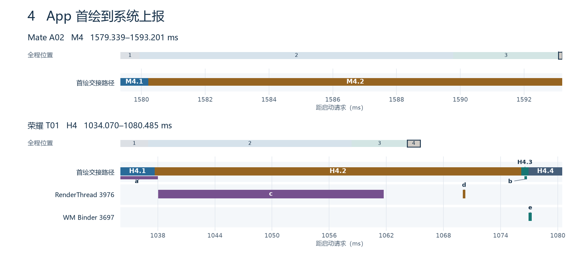

**Mate A02 · M4｜1579.339–1593.201 ms** · [↑ 总览](#stage-0)

| 标号 | 全程位置 (ms) | 耗时 (ms) | 内容 |
|---|---:|---:|---|
| M4.1 | 1579.339–1580.215 | 0.876 | App 首绘到 RenderService 收到绘制事务 |
| M4.2 | 1580.215–1593.201 | 12.986 | RenderService 收到事务到系统首帧上报 |
| **合计 M4** | **1579.339–1593.201** | **13.862** | 与上一级标注的区间相同 |

**荣耀 T01 · H4｜1034.069740–1080.484531 ms** · [↑ 总览](#stage-0)

| 标号 | 全程位置 (ms) | 耗时 (ms) | 内容 |
|---|---:|---:|---|
| H4.1 | 1034.069740–1037.678542 | 3.608802 | App 首绘开始到 RenderThread 开始绘制同一帧 |
| H4.2 | 1037.678542–1076.171875 | 38.493333 | RenderThread 首帧处理，含获取缓冲区 |
| H4.3 | 1076.171875–1076.948698 | 0.776823 | RenderThread 返回到系统收到绘制通知 |
| H4.4 | 1076.948698–1080.484531 | 3.535833 | 窗口管理系统收到通知到启动切片结束 |
| **合计 H4** | **1034.069740–1080.484531** | **46.414791** | 与上一级标注的区间相同 |

<!-- /timeline:04-system-report -->

Mate 的 Binder 事务 **11632259** 与绘制命令 **[6846,6]** 串起这一帧的 App 和 RenderService 证据，图上按接收事务划分两端。荣耀 **a、b** 是 App 主线程绘制和 `finishDrawing` 通知，**c、d** 是 RenderThread 获取缓冲区（**23.689115 ms**）与加载 `libadreno_utils.so`，**e** 是窗口管理的 Binder 线程处理 `finishDrawingWindow`。同一帧的 SurfaceFlinger 结束时间在 T01 的 **1104.036979 ms**，晚于此处使用的框架上报边界。

**Mate 17.1 ms，荣耀 44.9 ms。** Mate 从 App 首绘到提交绘制命令平均 **0.18 ms**，从提交到 RenderService 的首帧事件平均 **16.92 ms**，期间主线程可见资源 overlay 模块 `liboverlay.z.so` 的 `dlopen` 约 **1.22 ms**。荣耀从主界面 `draw-VRI` 开始到应用 `reportDrawFinished` 平均 **31.7 ms**，随后到系统启动切片结束平均 **13.2 ms**，此阶段主线程无可见 Bionic `dlopen`。按同一帧标识关联荣耀的 App、RenderThread 和 SurfaceFlinger，启动请求到 SurfaceFlinger 该帧结束平均 **1066.8 ms**，到窗口管理的启动上报平均 **1056.2 ms**。T07 单轮可见渲染线程等待缓冲区分配约 **69.0 ms**。两端系统上报点不同，后续可按同一屏幕呈现口径对齐。 荣耀逐帧核对（`honor-first-frame.csv`） · 查询 SQL（`honor-first-frame.sql`） · Mate 分段数据（`meituan-cangjie-startup-20261103/startup-samples.csv`）

## 优化顺序与验证指标

| 优先级 | 负责组件 | 先做什么 | 如何确认收益 |
|---|---|---|---|
| 1 | 美团启动入口、ArkTS 模块及 MRN/HMS 接入 | 顺着首屏 import 和 NAPI 注册链检查 MRN、扫码、WebView、语音等调用时机，对确属首屏之后才用的功能延后加载。 | 同包同机 A/B，比较 TPC 完成到 entry 开始的 **564.7 ms** 窗口，核对目标 SO 是否移出首帧，回归首屏与延后功能的首次使用。 |
| 1 | 仓颉业务编译产物、SDK 与 musl | 拆细业务 entry 的直接依赖，优先核对业务入口自身的包注册、`libohos.component.so` 等大闭包项。补逐 SO 的查找或复用、映射、重定位和构造埋点。 | 比较 entry `dlopen` 的 **385.6 ms** 和其后包初始化 **39.7 ms**，逐库核对实际来源、重定位耗时与 ABI。 |
| 2 | 业务前台逻辑、ArkUI | 追踪前台事务后到 UI 初始化前的等待来源，核对首屏页面布局和测量。 | 比较窗口创建到 App 首绘的 **356.0 ms**，单独观察 **106.4 ms** 主线程睡眠和首帧布局。 |
| 2 | 美团 Android 应用启动 | 给 `Application.onCreate`、Provider、业务 SDK 和 Splash 跳转加应用标记，定位绑定后半段和跳转等待中的同步工作。 | 同机 A/B，跟踪 **503.5 ms** 绑定后半段、**115.3 ms** Splash 创建后至 Main 创建和首显总耗时。 |
| 3 | 系统应用管理、两端渲染框架 | 对进程交接的慢轮次补任务和调度链，对首帧统一呈现口径。 | 分别比较请求到 App 初始化和 App 首绘到呈现，避免将不同上报点混用。 |

全量下沉模型按 175 个库复用及 96 个兼容项移除推算，平均可省 **134.8 ms**。这个数依赖实际复用和移除条件。若系统库在新应用进程仍需首次映射、重定位和构造，相应工作继续占用首帧路径。业务入口闭包还包含业务与三方代码，其装载、构造及注册须独立核对。同机同版本的兼容包与下沉包 A/B 才能量出净收益。 下沉估算报告（`meituan-cangjie-startup-20261103/美团众包仓颉全量下沉启动时间轴预估.md`） · 模型逐轮数据（`meituan-cangjie-startup-20261103/full-sinking-timeline-samples.csv`）

## 证据与复算

文中的本地证据引用保留文件名和原始定位。随文切片索引可按图号查找。

- 荣耀 8 轮正式 trace 的目标进程、生命周期、首绘切片和主线程调度区间均通过核对。Perfetto 服务的全局 `traced_chunks_discarded` 计数为 1 至 8，ftrace 未报告 overrun，两个应用阶段的主线程调度状态覆盖完整。 采集脚本（`capture_honor_trace.ps1`） · Perfetto 配置（`honor-startup.pbtxt`） · 分段校验脚本（`analyze_honor_trace.py`）
- 逐库 CSV 使用正式轮次。均值分母为同平台有效轮数，某轮没出现的该项按零纳入。事件表将跨阶段切片按区间裁剪，汇总表按库路径或请求名、阶段和线程角色汇总。多线程调用可以重叠，附表用于定位证据，首帧账本以连续时间段和同线程并集为准。 逐库提取脚本（`audit_startup_so.py`） · 逐库汇总（`startup-so-summary.csv`） · 逐轮切片明细（`startup-so-events.csv`）
- 编号图组从 A02 HiTrace 和 T01 Perfetto 提取。Mate 调度解析保留线程名含空格的 ftrace 记录。绘图脚本以整数纳秒验证各分段首尾相接、合计覆盖父段，并逐图核对放大范围与父图。图中标号的起止、裁剪边界、原始行号或 Perfetto `slice.id` 可按图名回查。 绘图与校验脚本（`render_startup_timelines.py`） · [图组切片索引](startup-timelines/timeline-marks.csv)

## 荣耀逐轮数据

H01–H20 按采集顺序，单位 ms。

```text
1009  1113  1099  1100  1133  1109  1006  1193  1089  1155
1078  1096  1046  1186  1093  1072  1082  1089  1195  1010
```

逐轮 CSV（含试采、PID 和启动状态）（`honor-raw/samples.csv`） · 首轮正式样本日志（`honor-raw/H01.txt`） · 末轮正式样本日志（`honor-raw/H20.txt`）
